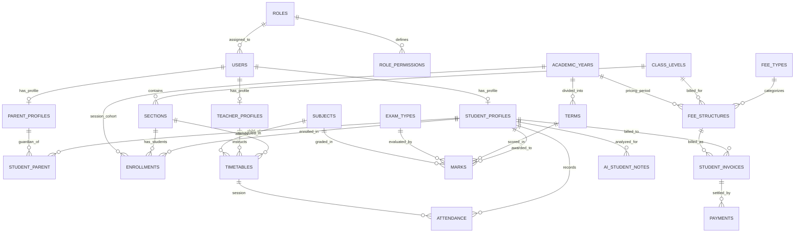

# Database Relationships and Entity Relationship Diagram

## Overview
This document specifies the relational architecture inferred and validated from the `ssms_db.csv` PostgreSQL metadata. 

---

## Entity Relationship Diagram (ERD)

---

## Detailed Relationships & Cardinality

### 1. Identity & Access Domain
* **`roles` -> `users` (1:N)**: Each user belongs to exactly one system role (`users.role_id` -> `roles.id`).
* **`roles` -> `role_permissions` (1:N)**: A role has multiple resource permission records (`role_permissions.role_id` -> `roles.id`), defining CRUD matrix.
* **`users` -> `student_profiles` (1:1)**: A student account is connected to its student profile (`student_profiles.user_id` -> `users.id`).
* **`users` -> `teacher_profiles` (1:1)**: A staff account is connected to its teacher profile (`teacher_profiles.user_id` -> `users.id`).
* **`users` -> `parent_profiles` (1:1)**: A parent account is connected to its guardian profile (`parent_profiles.user_id` -> `users.id`).

### 2. Family / Guardian Domain
* **`student_profiles` <-> `parent_profiles` (M:N via `student_parent`)**:
  * Junction table `student_parent` contains `student_id` and `parent_id`.
  * Supports multiple guardians per student (e.g. father, mother) and multiple students per guardian (siblings).

### 3. Academic Structure & Enrollment Domain
* **`academic_years` -> `terms` (1:N)**: An academic year has multiple terms/semesters (`terms.academic_year_id` -> `academic_years.id`).
* **`class_levels` -> `sections` (1:N)**: A grade level (e.g., Grade 5) contains multiple class sections (e.g., 5A, 5B) (`sections.class_level_id` -> `class_levels.id`).
* **`enrollments` (M:N Junction)**:
  * Connects `student_profiles` (`student_id`), `sections` (`section_id`), and `academic_years` (`academic_year_id`).
  * Enforces the student's active class section for a given academic year.

### 4. Scheduling & Attendance Domain
* **`timetables`**:
  * Multi-parent operational entity combining:
    * `sections.id` -> `timetables.section_id`
    * `subjects.id` -> `timetables.subject_id`
    * `teacher_profiles.id` -> `timetables.teacher_id`
  * Captures schedule slots: `day_of_week`, `start_time`, `end_time`, `classroom`.
* **`attendance` (1:N from `timetables` & `student_profiles`)**:
  * Records student presence per scheduled session: `timetable_id`, `student_id`, `date`, `status`, and `remarks`.

### 5. Assessment & Grading Domain
* **`marks`**:
  * Links:
    * `student_profiles.id` -> `marks.student_id`
    * `subjects.id` -> `marks.subject_id`
    * `exam_types.id` -> `marks.exam_type_id`
    * `terms.id` -> `marks.term_id`
  * Contains `score` and `max_score`, with `exam_types.weight_percentage` determining weighted course grade.

### 6. Billing & Financial Ledger Domain
* **`fee_types` -> `fee_structures` (1:N)**: A fee category (tuition, transport) defined across grade levels.
* **`class_levels` & `academic_years` -> `fee_structures` (1:N)**: Fee rates vary by grade level and school year.
* **`fee_structures` -> `student_invoices` (1:N)**: An invoice assesses a specific fee structure to a student.
* **`student_profiles` -> `student_invoices` (1:N)**: Invoices are addressed to individual students.
* **`student_invoices` -> `payments` (1:N)**: Payments record installments or full settlements against an invoice (`payments.invoice_id` -> `student_invoices.id`).

### 7. AI & Intelligent Analytics Domain
* **`student_profiles` -> `ai_student_notes` (1:N)**: AI or analytics engine writes notes, intervention triggers, and structured insights (`insights_json`) for each student.

---

## Assumption vs Confirmation Matrix

| Relationship | Foreign Key Columns | Assumed or Confirmed | Verification Rationale |
|---|---|---|---|
| Users to Roles | `users.role_id` -> `roles.id` | Confirmed by column name & types | Matching `id` PK and standard IAM structure |
| Student Profile to User | `student_profiles.user_id` -> `users.id` | Confirmed | Standard profile extension pattern |
| Teacher Profile to User | `teacher_profiles.user_id` -> `users.id` | Confirmed | Standard profile extension pattern |
| Parent Profile to User | `parent_profiles.user_id` -> `users.id` | Confirmed | Standard profile extension pattern |
| Student-Parent Junction | `student_parent.(student_id, parent_id)` | Confirmed | Explicit bridge table between student and parent profiles |
| Student in Enrollments | `enrollments.student_id` -> `student_profiles.id` | Confirmed | References `student_profiles.id` (not `users.id` directly) |
| Timetable Teacher | `timetables.teacher_id` -> `teacher_profiles.id` | Confirmed | Matches `teacher_profiles.id` |
| Attendance Timetable | `attendance.timetable_id` -> `timetables.id` | Confirmed | Clear link to timetable slot |
| Invoices to Fee Structure | `student_invoices.fee_structure_id` -> `fee_structures.id` | Confirmed | Financial fee assessment relationship |
| Payments to Invoice | `payments.invoice_id` -> `student_invoices.id` | Confirmed | Billing ledger relationship |
